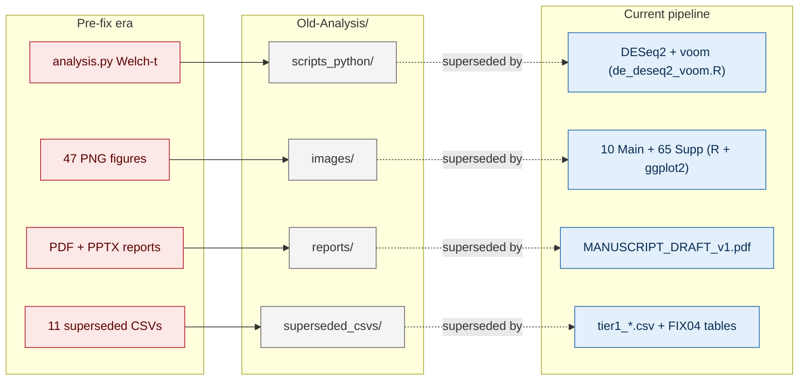

<p align="center">
  
</p>

<p align="center">
  
  
  
  
  
</p>

---

<div align="center">

*Everything from the GRBV Transcriptomics project that predates the April 2026 fix pass.*
<br/>
*Kept for reproducibility and reviewer-trail reasons.*
<br/>
<b>The current analysis pipeline does not read from this directory.</b>

</div>

---

## Why this exists



<blockquote align="center">
<b>The pre-fix pipeline used Welch's t-test on log2(CPM+1) without covariate adjustment.</b><br/>
<b>Everything downstream of that (pathway enrichment, biomarker discovery, figure scripts)</b><br/>
<b>was rebuilt during the April 2026 fix pass using DESeq2 + voom, proper permutation nulls,</b><br/>
<b>LOSO cross-validation, and R / ggplot2 figures.</b>
</blockquote>

---

## Archive at a glance

| Subdirectory | Contents | Size |
|---|---|---|
| `images/` | 55 PNG renders (`01_*` – `55_*` series) from the original Python figure pipeline | ~60 MB |
| `scripts_python/` | 19 scripts (17 analyses + 2 helpers); all Welch-t-era | ~400 KB |
| `generate_scripts/` | 5 PDF / PPTX builders for legacy deliverables | ~40 KB |
| `reports/` | Pre-fix PDFs, PPTX, markdown deliverables | ~108 MB |
| `superseded_csvs/` | 11 output tables that no current R script reads | ~1 MB |
| `farm_sensitivity_archive/` | Raw per-threshold sensitivity sweeps from the FARM extended pipeline | ~58 MB |

Post-fix equivalents (all in the live repo):

- Figures → [`../figures/main/`](../figures/main/) (Main01–Main10) and [`../figures/supp/`](../figures/supp/) (S02–S65)
- DE → [`../farm_pipeline/results/de_redo/`](../farm_pipeline/) + `de_extras/`
- Reports → [`../docs/MANUSCRIPT_DRAFT_v1.md`](../docs/MANUSCRIPT_DRAFT_v1.md), [`../docs/INTEGRATED_ANALYSIS.md`](../docs/INTEGRATED_ANALYSIS.md)

---

## `scripts_python/` — what each legacy script used to do

<details>
<summary><b>Click to expand the 17-script table</b></summary>

| Script | Pre-fix role | Replacement |
|---|---|---|
| `analysis.py` | Core DE for Q1–Q6 (Welch-t) | `de_deseq2_voom.R` |
| `pathway_enrichment.py` | GO / KEGG ORA, UP/DOWN + age-bin split | rebuild on DESeq2 DEGs |
| `causal_mediation_analysis.py` | Temp → Titer → Gene (tv = 500) | `mediation_tv2000.py` |
| `advanced_ml_biomarkers.py` | Random 5-fold CV, AUC = 1.000 | `biomarker_loso_cv.py` |
| `biomarker_discovery.py` | Pre-fix biomarker ranking | still referenced for composite score only |
| `chromosome_deg_hotspots.py` | Genome-wide DEG density (no permutation null) | `qtl_permutation_null.py` |
| `coexpression_network.py` | WGCNA (module assignments still used) | outputs remain canonical |
| `environment_titer_integration.py` | Weather + titer + DEG integration | rebuilt by `main07_wgcna_tf.R` |
| `grbv_biology_diagram.py` | Legacy mechanism diagram | `main10_biology_cascade.R` |
| `gsea_analysis.py` | GSEA across 8 conditions | outputs remain canonical (`gsea_results_all_conditions.csv`) |
| `gwas_qtl_crossref.py` | QTL overlap (no permutation null) | `qtl_permutation_null.py` |
| `heat_stress_signatures.py` | Heat-gene curation (115 genes × 9 categories) | outputs remain canonical |
| `multifactor_interaction_model.py` | Per-gene ANOVA (η² for Inf / Sea / Stg) | outputs remain canonical |
| `seasonal_maturity_progression.py` | Stage × season DE | `de_deseq2_extras.R` Q2x |
| `stratified_vs_pooled_comparison.py` | Pooled vs stratified concordance | `supp_robust_and_env.R` |
| `tf_family_analysis.py` | TF family profiling (6 families) | outputs remain canonical |
| `analysis_schematic.py` | Pipeline flowchart | Main10 + FIGURE_METHODS.md |

Plus two helpers: `scale_fonts.py`, `gsea_analysis.slurm`.

</details>

---

## `superseded_csvs/` — status of each archived CSV

<details>
<summary><b>Click to expand the 11-file table</b></summary>

| Archived CSV | Status |
|---|---|
| `advanced_ml_comparison.csv` | Replaced by `advanced_ml_comparison_FIX04.csv` at repo root |
| `stability_selection_results.csv` | Replaced by `stability_selection_FIX04.csv` at repo root |
| `Q1_pooled_vs_stratified.csv` | No replacement; analysis no longer run |
| `Q2_pooled_vs_stratified.csv` | No replacement; analysis no longer run |
| `biomarker_genomic_locations.csv` | Pre-fix; no R reference |
| `deg_hotspot_qtl_overlap.csv` | 1-byte empty file from the old pipeline |
| `heat_gene_temperature_correlations.csv` | Pre-fix; not read by any main / supp R script |
| `integrated_environment_titer_DEG.csv` | Pre-fix; not read by any R script |
| `interaction_gene_categories.csv` | Pre-fix; not read by any R script |
| `temperature_at_sampling.csv` | Pre-fix; not read by any R script |
| `universal_DEGs_across_approaches.csv` | Pre-fix; not read by any R script |

</details>

---

## `reports/` — pre-fix deliverables

| File | Description | Superseded by |
|---|---|---|
| `GRBV_Transcriptomics_Report.{pdf,md}` | Comprehensive Welch-t era report | [`docs/MANUSCRIPT_DRAFT_v1.md`](../docs/MANUSCRIPT_DRAFT_v1.md) |
| `GRBV_Transcriptomics_Presentation.pptx` | 64-slide conference deck | `GRBV_Funding_Committee_Presentation.pptx` (repo root) |
| `PAPER_WRITING_WORKFLOW.{pdf,md}` | 6-phase paper-writing guide | [`docs/INTEGRATED_ANALYSIS.md`](../docs/INTEGRATED_ANALYSIS.md) |
| `RESULTS_AND_DISCUSSION.{pdf,md}` | Early results / discussion draft | [`docs/MANUSCRIPT_DRAFT_v1.md`](../docs/MANUSCRIPT_DRAFT_v1.md) |
| `MOA.png` | Legacy mechanism-of-action diagram | Main10 cascade |

---

## Why some pre-fix-looking CSVs are *not* archived

Several CSV files at the repo root look pre-fix by name or timestamp but are **actively read by the current R figure scripts**. They are kept live:

<details>
<summary><b>Click to expand</b></summary>

- `heat_stress_DEGs_all_conditions.csv`, `heat_DEGs_recurrence.csv` — Main04, S34, S35
- `gsea_results_all_conditions.csv` — Main09, S37–S39
- `chromosome_deg_density.csv` — Main08, S51–S52
- `multifactor_anova_results.csv`, `interaction_gene_categories.csv` — S40–S42
- `tf_family_DE_summary.csv`, `tf_family_gene_details.csv` — Main07, S43–S45
- `mediation_results.csv` — Main05, S49, S50 (post-fix, `mediation_tv2000.py` rerun)
- `stability_selection_FIX04.csv`, `advanced_ml_comparison_FIX04.csv` — Main06, S47
- `MEs.csv`, `hub_genes_per_module.csv`, `module_trait_correlations.csv`, `coexpression_modules.csv` — Main07, S53–S55
- `GRBV_biomarker_QTL_crossref.csv`, `GRBV_biomarkers_top50.csv`, `consensus_biomarker_panel.csv` — Main06, Main08
- `daily_2021.csv`, `daily_2022.csv` — weather inputs for environment panels

These are the CSVs with at least one `grep -l "$csv" figures/scripts_R/*.R` hit at the time of the cleanup. Do not archive them without a matching script update.

</details>

---

## Restoring a pre-fix artefact

Each file here is the same content that used to sit at repo root (PNG / PDF / CSV / PPTX) or inside `Old_figure/` (the earlier images + scripts sub-archive). If you need to resurrect one:

```bash
# Copy forward (recommended)
cp Old-Analysis/images/01_global_pca_overview.png ./

# Or symlink
ln -s Old-Analysis/images/01_global_pca_overview.png ./
```

Do not *move* files out of this directory. The live pipeline has no dependency on this archive, but third-party readers (old Welch-t DOIs, earlier submissions) may still resolve paths that lead here.

---

## Commit reference

Cleanup executed **2026-04-22**; the parent commit staged just before the move is tagged as *"Checkpoint before folder streamlining cleanup"*. The move itself is the next commit on `master`.

---

<div align="center">

**Part of the [GRBV Transcriptomics Analysis](../README.md) project**
<br/>
*Prem Pratap Singh · UC Davis Viticulture & Enology · 2024–2026*

</div>
