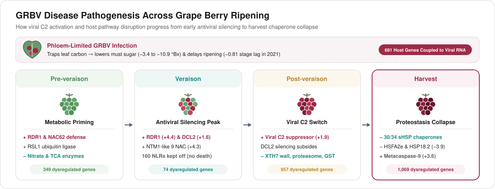
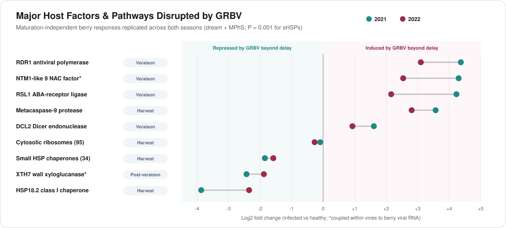
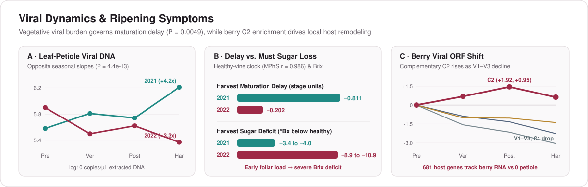
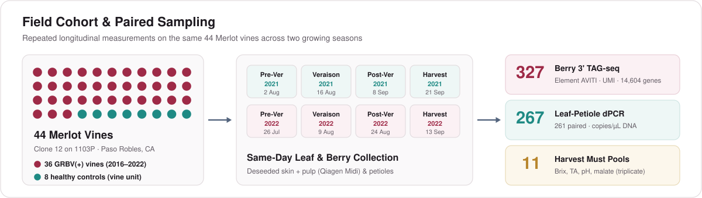
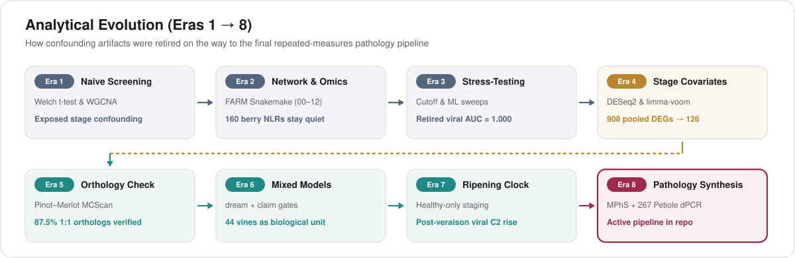

<div align="center">
  <h1>Grapevine Red Blotch Disease Pathogenesis in Ripening Berries</h1>
  <p><strong>Stage-resolved viral <em>C2</em> activation, host pathway disruption, and ripening delay across 44 field-grown Merlot vines</strong></p>
  <p>
    <a href="LICENSE"></a>
    
    
    
    
  </p>
</div>

<p align="center">
  
</p>

> [!NOTE]
> **Pre-publication repository:** Because the manuscript is currently in preparation, unpublished manuscript files, main publication figures, count matrices, and raw sequencing reads are withheld until publication. This repository provides the reproducible statistical analysis code and high-level study overview.

## Project at a glance

- **Early antiviral silencing without cell death:** Around veraison, infected berries induce *RDR1*, *DCL2*, *NAC62*, *NTM1-like 9*, and *RSL1* while keeping all `160` expressed berry NLR receptors restrained.
- **Post-veraison viral *C2* switch & proteostasis collapse:** After veraison, complementary-sense *C2* rises (`+1.92`, `+0.95` log2), covarying locally with `681` host genes as *DCL2* subsides and cell-wall (*XTH7*), ribosome, 26S proteasome, and *sHSP* chaperones (`30/34` genes) drop alongside *metacaspase-9* induction.
- **Delayed ripening vs. sugar loss:** Foliar viral DNA load (`267` petiole dPCR chips; *Singh et al., 2026*) predicts berry maturation delay (`P = 0.0049`), while early-season leaf viral burden precedes severe harvest sugar deficits (`−8.9 to −10.9 °Bx`).

---

## Disrupted host pathways & viral dynamics

<p align="center">
  
</p>

<p align="center">
  
</p>

---

## Field cohort & analytical evolution

<p align="center">
  
</p>

<p align="center">
  
</p>

---

## Repository & reproduction

```text
.
├── Current_Analysis/
│   ├── simplified_reanalysis_2026-11/   # Mixed-model (dream), zenith, permutation & petiole dPCR scripts
│   └── mphs_external_check_2026-11/     # External Molecular Phenology Scale (MPhS v0.1.4) validation
├── figures/readme/                      # High-level overview schematics for this README
├── CITATION.cff
└── LICENSE
```

```bash
Rscript Current_Analysis/simplified_reanalysis_2026-11/01_data_audit.R
Rscript Current_Analysis/simplified_reanalysis_2026-11/02_developmental_score.R
Rscript Current_Analysis/simplified_reanalysis_2026-11/04_adjusted_dream.R
Rscript Current_Analysis/simplified_reanalysis_2026-11/10_petiole_dpcr_integration.R
python3 Current_Analysis/mphs_external_check_2026-11/verify_mphs.py
```

---

## Citation & acknowledgments

Code is [MIT licensed](LICENSE) ([`CITATION.cff`](CITATION.cff)); raw 3' TAG-seq reads and manuscript files will be released upon publication. Companion petiole dPCR dataset: *Singh et al. (2026), Arch. Virol. 171:183*.

In memoriam **Dr. Anita Oberholster** (UC Davis Viticulture & Enology). Conducted with **Dr. Mysore R. Sudarshana** (USDA-ARS / UC Davis Plant Pathology), **Dr. David E. Block**, and **Bradley N. Jenner**, supported by CDFA, USDA, and UC Davis FARM HPC. Maintained by **Prem Pratap Singh** (UC Davis).
