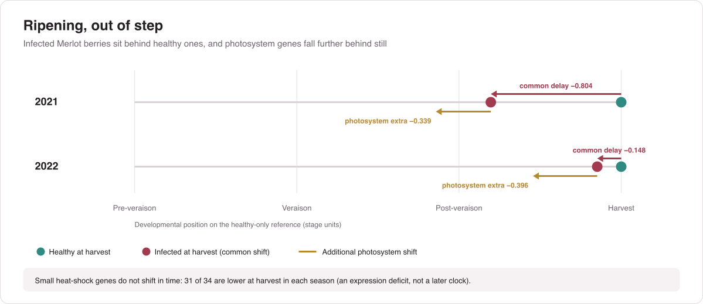
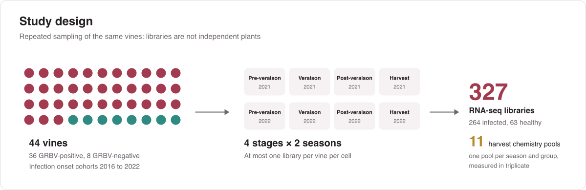
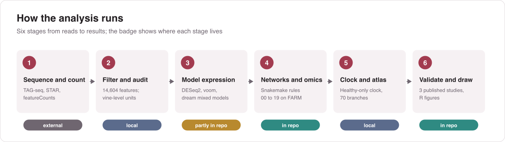
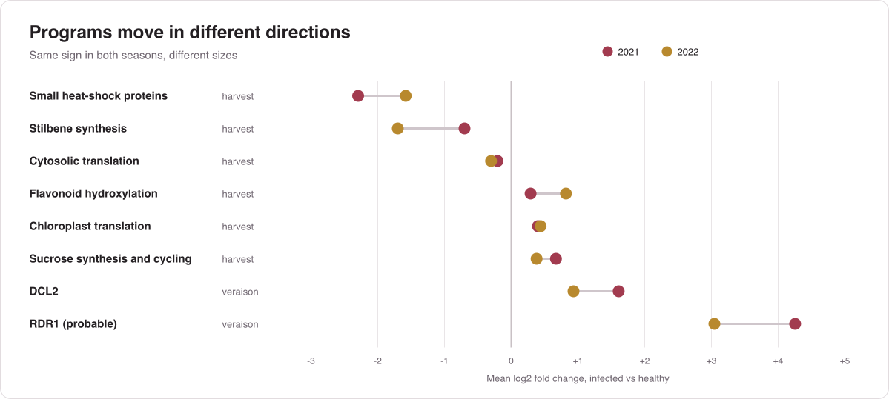
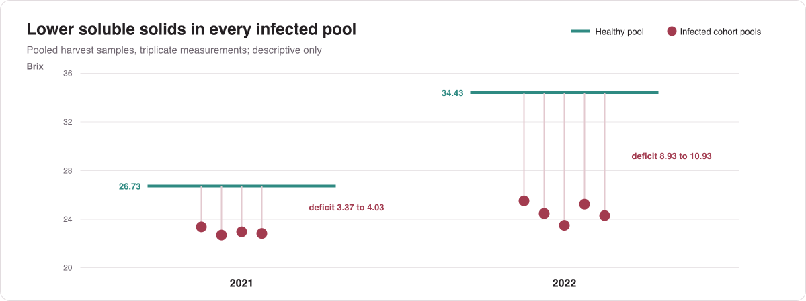
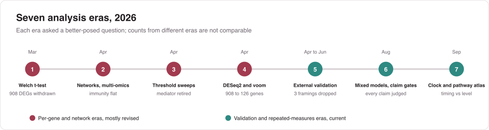

<div align="center">
  <h1>GRBV Transcriptomics Analysis</h1>
  <p><strong>Grapevine red blotch disease does not just delay ripening. It pulls ripening programs out of step.</strong></p>
  <p>327 RNA-seq libraries · 44 Merlot vines · 4 ripening stages · 2 seasons</p>
  <a href="#the-key-insight">Insight</a> ·
  <a href="#study-design">Design</a> ·
  <a href="#method">Method</a> ·
  <a href="#results">Results</a> ·
  <a href="#reproduce">Reproduce</a> ·
  <a href="#citation">Cite</a>
</div>

<p align="center">
  <a href="LICENSE"></a>
  
  
  
  
</p>

<p align="center"></p>

> [!NOTE]
> **The manuscript is a complete scientific draft (October 2026), not yet submitted.** Raw reads, the count matrix and the manuscript are not public yet, so this repository holds the analysis code. Every number below comes from that draft.

## The question

Grapevine red blotch virus (GRBV) slows berry ripening: infected fruit reaches harvest with less sugar. Earlier studies saw persistent early-development gene expression, altered hormones and changes in ripening metabolism in infected berries. That leaves an open question. Is the infected transcriptome simply a delayed version of the healthy one, or do some ripening programs go off on their own?

The answer matters for how disease effects are read. If infection only delays development, most "disease genes" are just genes caught at an earlier stage. If programs fall out of step with each other, some changes are real disease effects beyond the delay.

## The key insight

The analysis builds a developmental reference from **healthy berries only** and places every infected sample on it. That separates two kinds of change:

- **A common delay.** At harvest, infected berries sit **0.804 stage units** behind healthy ones in 2021 (95% vine bootstrap −1.023 to −0.573, FDR 0.0008) and **0.148** behind in 2022 (FDR 0.034).
- **Program-specific timing.** Photosystem and light-harvesting genes sit a further **0.339 (2021) and 0.396 (2022)** units behind, FDR 0.0016 in both seasons. Branch-specific timing predicts genes held out of the fit better than a shared expression shift.
- **Program-specific level.** Small heat-shock genes do not shift in time. **31 of 34** are significantly lower at harvest in each season, and their branch fails the season-transfer test for its own clock. This is an expression deficit, not a different developmental age.

Infection changes how ripening programs line up with each other, not just how fast the berry ripens.

## Study design

<p align="center"></p>

Each vine was sampled at up to eight stage × season cells, so libraries are repeated observations of the same plants. There are **8 control vines, not 63 control plants**, and every model treats the vine as the unit. Infected vines come from onset cohorts 2016 to 2022. Harvest chemistry was measured on 11 pooled samples, one per season and group, each in triplicate.

## Method

<p align="center"></p>

| Stage | What happens | Where |
|:-:|---|---|
| 1 | TAG-seq libraries on Element AVITI; HTStream trimming, umi_tools deduplication, STAR against Pinot Noir ASM3070453v1, featureCounts | UC Davis Bioinformatics Core |
| 2 | 28,168 features filtered to 14,604 (≥10 counts in ≥10% of libraries); each analysis checked for how many independent vines it really has | local |
| 3 | Covariate-adjusted DESeq2 and limma-voom, then gene-wise mixed models with a vine random intercept (`variancePartition::dream`) | [`de_deseq2_voom.R`](farm_pipeline/scripts/de_deseq2_voom.R); mixed models local |
| 4 | GENIE3, WGCNA preservation, NMF, differential co-expression, motifs, pseudotime, MOFA, mediation, defence repertoire (Snakemake rules 00 to 19) | [`farm_pipeline/Snakefile`](farm_pipeline/Snakefile) |
| 5 | Healthy-only developmental clock, 70 annotation-defined branches, rotation tests, 4,999 vine-bootstrap draws, leave-one-vine-out | local |
| 6 | Concordance with published GRBV studies; R figure scripts and the figure atlas | [`farm_pipeline/scripts/`](farm_pipeline/scripts/), [`figures/scripts_R/`](figures/scripts_R/) |

## Results

### Programs move in different directions

<p align="center"></p>

- **Translation splits by compartment.** Cytosolic translation-associated transcripts fall while chloroplast-associated ones rise; both branch tests pass in both seasons.
- **Phenylpropanoid metabolism splits by step.** Entry, lignin, anthocyanin and stilbene steps fall; flavonoid hydroxylation rises.
- **Sugar metabolism rises late, transport does not change.** Sucrose and starch synthesis go up at harvest; the aggregate sugar-transporter branch is not significant.
- **RNA silencing comes early.** DCL2 and probable RDR1 rise at veraison in both seasons and return to control levels by harvest.
- **Season matters.** 7,861 host genes show an infection × stage effect. Another test finds 3,236 with infection × stage × season, and 1,223 of those are missed when seasons are averaged.

### Lower soluble solids in every infected pool

<p align="center"></p>

pH is also lower in every infected pool. Titratable acidity and malic acid go up in infected pools in 2021 and down in 2022. The larger Brix deficit falls in the season with the smaller transcriptional delay, so chemistry and transcriptome capture different parts of the disease. These pools are descriptive: their spread is measurement variation, not variation among vines.

### Independent data and immunity

| Check | Result |
|---|---|
| Blanco-Ulate et al. 2017, Zinfandel | Rank correlation rises from −0.066 before veraison to **0.412 at harvest**; 64.5% sign agreement over 11,619 genes |
| Rumbaugh et al. 2023, Merlot | ρ 0.72 |
| Rumbaugh et al. 2022, Cabernet Sauvignon | ρ 0.24 to 0.36; agreement falls with genetic distance |
| Leave each of 44 vines out | Harvest signs of the sHSP, cytosolic-translation and photosystem branches hold every time |
| Canonical immunity | 160 well-expressed NLRs are detected like housekeeping genes but barely move (median \|log2FC\| 0.19 vs 1.06 for sHSPs) |

All effects are relative RNA abundance. The study makes no claims about protein activity, hormone levels, metabolic flux or a causal role for temperature.

## What changed along the way

<p align="center"></p>

Several early headline claims were tested and withdrawn. Counts from different eras answer different questions, so they should not be compared directly.

<details>
<summary><strong>Claims withdrawn, and why</strong></summary>

| Earlier claim | Why it was withdrawn |
|---|---|
| 908 universal DEGs | Confounded with ripening stage; 126 under covariate adjustment |
| 3-gene panel with AUC = 1.000 | Depended on viral transcripts; host-only, season-held-out AUC is 0.73 to 0.88 |
| MBF1c as the causal mediator | Bayesian vine model: −0.25 [−0.81, +0.33] |
| Three phases of chronic infection | Segmented regression selects zero breakpoints |
| Blocked sugar translocation | Sugar-transport module shows no infection effect |
| Vine tolerance gradient | Built on chemistry rows duplicated across RNA stages |
| Early burden predicts late damage | Failed both prespecified endpoints |
| Temperature causes the season effect | Two seasons cannot identify a causal climate mechanism |
| 60% QTL co-localisation | Computed on placeholder gene positions |

</details>

## Limitations

| Limit | What it means |
|---|---|
| 8 healthy vines | Control-side estimates rest on 8 biological units, sampled repeatedly |
| Two seasons | Season effects are reported; their climatic cause cannot be identified |
| Pooled harvest chemistry | One pool per season × cohort; no vine-level chemistry associations |
| Annotation-defined branches | Compartment and pathway assignments come from annotation, not localisation |
| Pinot Noir reference | Merlot reads mapped to Pinot Noir; genes significant under both references agree in direction 100% of the time |
| Data not deposited | Raw reads and counts are not yet in SRA or GEO |
| Local-only steps | The sample audit, mixed models and developmental clock (stages 2, 3 and 5) are not yet in this repository |

> [!CAUTION]
> Older figures and decks in the project history use withdrawn claims. Check a result against [Results](#results) before reusing it.

## Reproduce

The repository is private; you need access to clone it. Input data are not included.

```bash
git clone https://github.com/prem-p-singh/GRBV-Transcriptomics-Analysis.git
cd GRBV-Transcriptomics-Analysis
pip install -r requirements.txt
```

**Input data.** [`push.sh`](farm_pipeline/push.sh) copies these from `~/Data_Analysis/` into `farm_pipeline/data/` and syncs the pipeline to `farm:~/grbv_extended/`.

| File | Contents |
|---|---|
| `counts_matrix.txt` | Raw counts, 28,168 features × 327 libraries |
| `sample_metadata.txt`, `sample_metadata_v2.txt` | Infection group, season, stage, infection year; v2 adds vine and replicate IDs |
| `Virus titer.txt` | Viral titer by season, year, replicate and stage (copied as `Virus_titer.txt`) |
| `daily_2021.csv`, `daily_2022.csv` | Daily weather for each season |
| `MEs.csv`, `Module_genes.xlsx` | WGCNA module eigengenes and membership |

**FARM pipeline.** [`setup_farm.sh`](farm_pipeline/setup_farm.sh) builds the `grbv-extended` Conda environment, installs R packages for `R/4.4.2` into `~/grbv_extended/Rlibs`, and downloads the reference genome, PlantTFDB TF list and JASPAR plant motifs. Both setup and [`run_farm.sh`](farm_pipeline/run_farm.sh) re-run themselves inside an `srun` job (account `publicgrp`, partition `low`) when started on a login node. Start a `tmux` session first, because the controller stops if SSH drops.

```bash
# On the Mac, from farm_pipeline/
bash push.sh

# On FARM
cd ~/grbv_extended
bash setup_farm.sh
bash run_farm.sh -n     # dry run: list the jobs Snakemake would submit
bash run_farm.sh        # submit; rerun to resume after preemption

# Back on the Mac, from farm_pipeline/
bash pull.sh            # copy results/ and logs/ back
```

The [FARM profile](farm_pipeline/profiles/farm/config.yaml) runs up to 10 SLURM jobs on the `low` partition with requeue. Thresholds live in [`config/config.yaml`](farm_pipeline/config/config.yaml).

**Figures.** Paper figures are R scripts that source [`theme_grbv.R`](figures/scripts_R/theme_grbv.R) and write PNG and SVG. The README figures are generated by [`figures/readme/make_figures.py`](figures/readme/make_figures.py), then exported from Illustrator with text as outlines.

```bash
Rscript figures/scripts_R/S87_phenylpropanoid_kegg.R
python figures/scripts_R/build_full_atlas.py
python figures/readme/make_figures.py
```

<details>
<summary><strong>Where results land</strong></summary>

| Location | Contents |
|---|---|
| `farm_pipeline/results/<rule>/` | Per-rule tables and diagnostic plots (not publication figures) |
| `farm_pipeline/results/de_redo/`, `de_extras/` | DESeq2 and voom contrasts with a `stat` column |
| `farm_pipeline/logs/` | SLURM and rule logs |
| `figures/main/`, `figures/supp/` | Publication figures, PNG + SVG at 600 dpi |
| [`figures/GRBV_Full_Figure_Atlas.pdf`](figures/GRBV_Full_Figure_Atlas.pdf) | Every figure with its caption and status |

Positive log2FC means higher in infected than in healthy berries of the same stage and season. Diagnostic plots in `results/` only show that a rule ran; paper figures are always redrawn in R.

</details>

## Citation

Source is [MIT licensed](LICENSE). Cite with [CITATION.cff](CITATION.cff); the manuscript is in preparation:

> Singh, P.P., et al. *Grapevine red blotch disease alters the temporal coordination of fruit ripening programs.* In preparation.

The study began in the lab of **Dr. Anita Oberholster** (UC Davis Viticulture and Enology), who passed away in January 2025. It continued with **Dr. David E. Block** and is now carried out with **Dr. Mysore R. Sudarshana** (USDA-ARS and UC Davis Plant Pathology). RNA-seq processing by **Bradley N. Jenner**. Funded by CDFA and USDA. Computing on UC Davis FARM.

Maintained by **Prem Pratap Singh**, Department of Plant Pathology, University of California, Davis.
