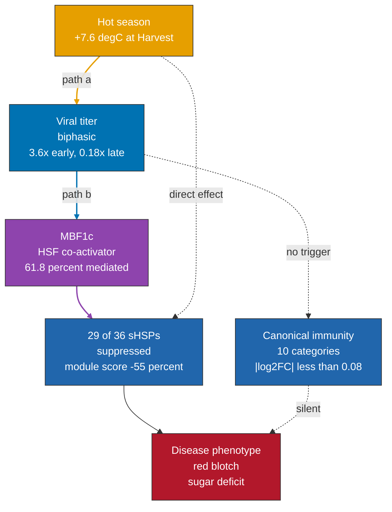
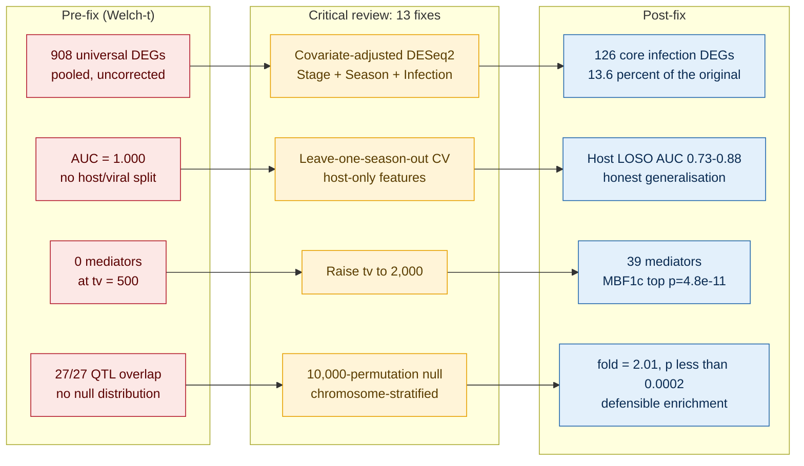
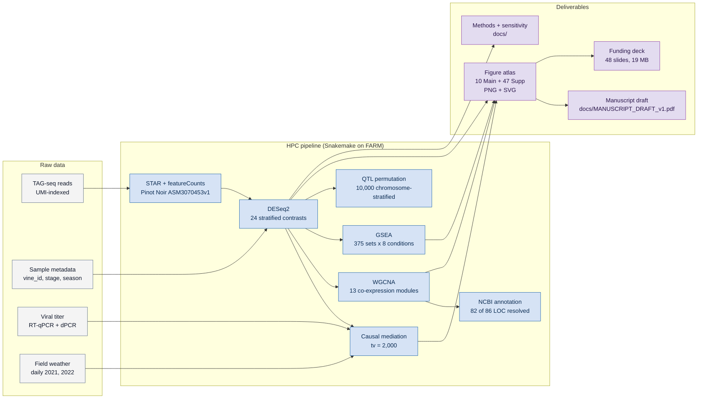
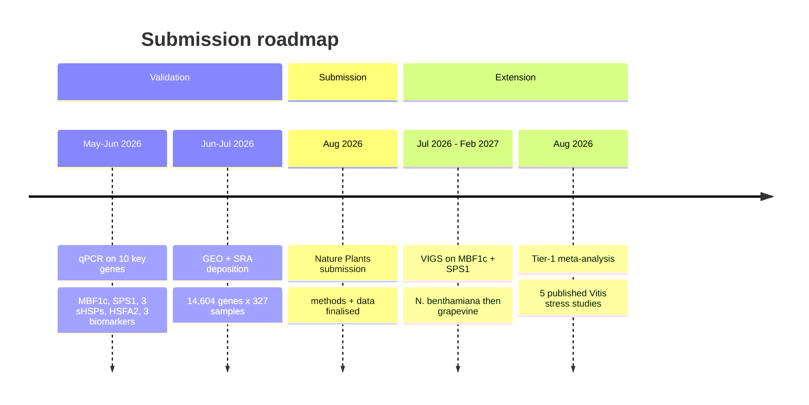

<p align="center">
  
</p>

<p align="center">
  
  
  
  
  
</p>

---

<div align="center">

*A 327-sample RNA-Seq study asking how Grapevine Red Blotch Virus rewires the* ***Vitis vinifera*** *(Merlot)*
<br/>
*transcriptome, how temperature modulates that rewiring, and which host genes carry*
<br/>
*the causal weight between the two.*

</div>

---

## The story in one diagram



<blockquote align="center">
<b>The headline is not that GRBV is fighting the plant.</b><br/>
<b>It is that GRBV is quieting one specific arm of the plant's stress biology,<br/>
the small heat-shock protein axis, while slipping past canonical immune defense<br/>
without triggering it at all.</b>
</blockquote>

---

## Study at a glance

| | |
|---|---|
| Species | *Vitis vinifera* cv. Merlot, one commercial vineyard, 10+ blocks |
| Samples | 327 (264 RB+, 63 RB-) |
| Seasons | 2021 (cool), 2022 (hot, +7.6 °C at Harvest) |
| Maturity stages | Pre-véraison, Véraison, Post-véraison, Harvest |
| Infection cohorts | 7 onset years (2016–2022), n = 105–214 DEGs each |
| Sequencing | TAG-seq (UMI-indexed) · STAR · Pinot Noir ASM3070453v1 |
| Primary DE design | DESeq2 Wald, `~ Maturity_stage + Sampling_Season + Infection_Group`, BH-FDR < 0.05, \|log₂FC\| ≥ 1 |
| Figures | 10 Main composites + 47 Supplementary, PNG + SVG |

<p align="center">
  
</p>

<p align="center"><i>Main Figure 3. The inverted seasonal DEG trajectory. 2021 peaks at Harvest (1,567 DEGs); 2022 peaks earlier at Post-véraison (772). Viral titer runs 3.6x higher in the hot year at Pre-véraison and 0.18x at Harvest: the biphasic titer pattern is the mechanistic hinge.</i></p>

---

## Three threads, one story

<table>
<tr><td align="center" width="50"><b>1</b></td><td>

### Inverted seasonal trajectory *(Q3, Q4)*

2021 peaks at **Harvest with 1,567 DEGs**. 2022 peaks earlier at **Post-véraison with 772**, falling back to 759 by Harvest. Cross-season fold-change correlation rises with maturity: r = 0.34 at Pre-véraison, **r = 0.67 at Post-véraison**. The direction switch is mechanistically driven by biphasic viral titer: higher early in hot years, lower late, flipping the timing of disease expression.

</td></tr>
<tr><td align="center"><b>2</b></td><td>

### Thermal defense silenced, canonical immunity untouched

**29 of 36 small heat-shock proteins** (sHSPs) are down-regulated in infected vines. HSF ↔ sHSP coordination stays coherent (**r = 0.625, p = 7.2e-37**) but the sHSP module score drops from +1.64 in healthy vines to +0.74 in infected (**55 % reduction**). All 10 canonical plant-immunity categories (NLR, PRR, PR, SA, JA, ET, WRKY, callose, ROS, R-adapters) show \|log₂FC\| < 0.08. GRBV is not triggering effector-triggered or pattern-triggered immunity. It is dampening thermal defense.

</td></tr>
<tr><td align="center"><b>3</b></td><td>

### MBF1c, SPS1, and 37 other mediators

Causal-mediation sweep on the top 2,000 variable genes returns **39 temperature → titer → gene mediators** at joint BH-FDR < 0.05. The top hit, LOC100249249, turns out to be **multiprotein-bridging factor 1c (MBF1c)**, a known HSF co-activator: joint p = 4.8 × 10⁻¹¹, **61.8 % of the temperature effect mediated by viral titer**. Second-tier robust mediator is LOC100232974 = **sucrose-phosphate synthase 1 (SPS1)**. Paired harvest biochemistry (Figs S61-S63, n = 33) shows SPS1 correlates *negatively* with Brix within-season (2021 ρ = −0.73), so SPS1 is up-regulated in the infected, low-Brix berries. The mediator status stands; the role is compensatory, not rate-limiting.

</td></tr>
<tr><td align="center"><b>4</b></td><td>

### Harvest juice chemistry mirrors the inverted seasonal trajectory

Two-way Season × Infection ANOVA on n = 33 paired harvest samples confirms the transcriptomic inversion in the phenotype. **TA** is the cleanest mirror: no main effect of season (p = 0.69) or infection (p = 0.16), but the Season × Infection interaction reaches **η² = 0.77, p = 4.3 × 10⁻¹¹**. GRBV raises TA by **+0.62 g/L in 2021 cool** and lowers it by **−0.79 g/L in 2022 hot**; malic acid follows the same inversion (+398 vs −195 mg/L). Brix is suppressed in both seasons but **2.6× stronger in 2022** (−9.83 vs −3.77 °Bx). In 2021 a biphasic cohort-age recovery appears at harvest: Brix rises +0.10 °Bx / yr with years-since-infection (r = 0.76, p = 0.0045) while nitrogen markers decline.

</td></tr>
</table>

---

## What changed under the reanalysis



<blockquote align="center">
<i>The data layer came out of the reanalysis richer (24 covariate-adjusted contrasts,</i>
<br/>
<i>including per-stage x per-season cells). The manuscript claims came out honest.</i>
</blockquote>

Full documentation: <a href="docs/CRITICAL_REVIEW.md">CRITICAL_REVIEW.md</a>, <a href="docs/DE_REANALYSIS_REPORT.md">DE_REANALYSIS_REPORT.md</a>, <a href="docs/SENSITIVITY_REPORT.md">SENSITIVITY_REPORT.md</a>, <a href="docs/METHODS_ADDENDUM.md">METHODS_ADDENDUM.md</a>.

---

## Analysis pipeline



---

## Repository layout

<details>
<summary><b>Click to expand full tree</b></summary>

```
.
├── figures/
│   ├── main/               Main01-Main10 composite figures (PNG + SVG)
│   ├── supp/               S02-S55 supplementary figures (PNG + SVG)
│   ├── scripts_R/          R / ggplot2 scripts for every figure
│   │   └── theme_grbv.R    Shared theme + palette + save_grbv() helper
│   ├── GRBV_Main_Figures_Atlas.pdf       10-page main atlas
│   └── GRBV_Full_Figure_Atlas.pdf        65-page full atlas
├── farm_pipeline/
│   ├── Snakefile           13 rules, 24 DE contrasts, sensitivity sweeps
│   ├── scripts/
│   ├── results/            fix01, fix01c, fix03, fix10, fix11 + rules 00-10
│   ├── data/, resources/
│   └── docs/
│       └── LITERATURE_SCHEMA.md
├── docs/                   Project-level deliverables (14 files)
│   ├── MANUSCRIPT_DRAFT_v1.{md,pdf}
│   ├── INTEGRATED_ANALYSIS.{md,pdf}
│   ├── CRITICAL_REVIEW.{md,pdf}
│   ├── DE_REANALYSIS_REPORT.md
│   ├── METHODS_ADDENDUM.md
│   ├── HSFA2_VIGS_EXPERIMENT_PLAN.md
│   ├── SENSITIVITY_REPORT.{md,pdf}
│   ├── EXTENDED_RESULTS_REPORT.{md,pdf}
│   └── PLAIN_LANGUAGE_SUMMARY.md
├── Old-Analysis/           Pre-fix era archive
│   ├── images/             55 legacy PNGs from Python pipeline
│   ├── scripts_python/     19 pre-fix analysis scripts
│   ├── generate_scripts/   5 pre-fix PDF / PPTX builders
│   ├── reports/            8 legacy deliverables
│   ├── superseded_csvs/    11 CSVs with zero current-R-script references
│   └── farm_sensitivity_archive/        58 MB raw threshold sweeps
├── GRBV_Funding_Committee_Presentation.pptx     48-slide committee deck
├── counts_matrix.txt + sample_metadata.txt + 19 active-pipeline CSVs
├── org.Vvinifera.eg.db/, go-basic.obo
├── CLAUDE.md               Project memory / session context
└── README.md               This file
```

</details>

---

## Running it

### Figures

Every figure is an R / ggplot2 script in [`figures/scripts_R/`](figures/scripts_R/). Each script sources [`theme_grbv.R`](figures/scripts_R/theme_grbv.R) (project palette + save helper) and writes **PNG + SVG** to `figures/main/` or `figures/supp/`.

```bash
# One figure
Rscript figures/scripts_R/main03_inverted_trajectory.R

# A whole supplementary batch (S02 through S07)
Rscript figures/scripts_R/supp_de_overview.R

# Rebuild the atlases from the current PNG set
python figures/scripts_R/build_atlas.py
python figures/scripts_R/build_full_atlas.py
```

<details>
<summary><b>Output formats</b></summary>

- **PNG**: 600 dpi, via `ragg::agg_png`, Arial fonts reliable on macOS
- **SVG**: vector, via `svglite::svglite`, opens cleanly in Illustrator, Inkscape, Figma
- **PDF**: opt-in with `save_grbv(..., formats = c("png","pdf"))` via `cairo_pdf`
- **Atlases**: 2 PDFs assembled directly from PNGs (reportlab)

</details>

### FARM HPC pipeline

The extended analysis runs as a Snakemake pipeline on UC Davis FARM.

```bash
cd farm_pipeline
bash setup_farm.sh      # install R packages + annotation resources
bash run_farm.sh        # submit to partition low, account publicgrp
bash pull.sh            # rsync results back to local figures/
```

### Funding-committee deck

Generated by [pptxgenjs](https://gitbrent.github.io/PptxGenJS/) via a Node.js script. Output is 48 slides, 19 MB, with 10 Main + 6 Supp figures embedded and a Q-tag in the top-right of every result slide showing which research question each figure answers.

---

## Deliverables

<div align="center">

| Asset | Location | Size |
|---|---|---|
| Manuscript draft (with figures embedded) | [`docs/MANUSCRIPT_DRAFT_v1.pdf`](docs/MANUSCRIPT_DRAFT_v1.pdf) | 9.6 MB |
| Main figures atlas | [`figures/GRBV_Main_Figures_Atlas.pdf`](figures/GRBV_Main_Figures_Atlas.pdf) | 11 MB |
| Full atlas (main + supp) | [`figures/GRBV_Full_Figure_Atlas.pdf`](figures/GRBV_Full_Figure_Atlas.pdf) | 36 MB |
| Methods addendum | [`docs/METHODS_ADDENDUM.md`](docs/METHODS_ADDENDUM.md) | 16 KB |
| Committee deck | [`GRBV_Funding_Committee_Presentation.pptx`](GRBV_Funding_Committee_Presentation.pptx) | 19 MB |
| Wet-lab plan (VIGS) | [`docs/HSFA2_VIGS_EXPERIMENT_PLAN.md`](docs/HSFA2_VIGS_EXPERIMENT_PLAN.md) | 17 KB |
| Critical review + fix log | [`docs/CRITICAL_REVIEW.pdf`](docs/CRITICAL_REVIEW.pdf) | 23 KB |
| Integrated analysis | [`docs/INTEGRATED_ANALYSIS.pdf`](docs/INTEGRATED_ANALYSIS.pdf) | 28 KB |

</div>

---

## What's next



---

## Acknowledgments

<table>
<tr><td width="30%" align="right" valign="top"><b>In memoriam</b></td>
<td>
The founding PI, <b>Dr. Anita Oberholster</b> (UC Davis Viticulture and Enology, 1980 to 2025), passed away in January 2025. Her lab built the field-sampling design, ran the wet-lab, and framed the year-one manuscript. Every result here sits on that foundation.
</td></tr>
<tr><td align="right" valign="top"><b>Mentorship</b></td>
<td><b>Dr. David E. Block</b>, UC Davis V and E. Current PI of record; manuscript strategy; resource allocation on FARM.</td></tr>
<tr><td align="right" valign="top"><b>Virology co-authorship</b></td>
<td><b>Dr. Mysore R. Sudarshana</b>, USDA-ARS and UC Davis Plant Pathology. Field-site liaison; viral-titer wet-lab; co-author on two in-preparation manuscripts.</td></tr>
<tr><td align="right" valign="top"><b>RNA-Seq pipeline</b></td>
<td><b>Bradley N. Jenner</b>, UC Davis Bioinformatics Core (2025-04-15 to 2025-05-12). TAG-seq QC, HTStream, umi_tools dedup, STAR, featureCounts.</td></tr>
<tr><td align="right" valign="top"><b>Funding</b></td>
<td>USDA-ARS grapevine pathology programs; California Department of Food and Agriculture (CDFA) specialty-crop block grants.</td></tr>
<tr><td align="right" valign="top"><b>Compute</b></td>
<td>UC Davis FARM HPC, partition <code>low</code>, account <code>publicgrp</code>.</td></tr>
<tr><td align="right" valign="top"><b>Annotation</b></td>
<td>NCBI; <code>org.Vvinifera.eg.db</code>; Gene Ontology Consortium; KEGG.</td></tr>
</table>

---

## Citing

<blockquote>
Singh, P.P., Block, D.E., Sudarshana, M.R., Oberholster, A. (in preparation).<br/>
<i>Biphasic temperature drives viral titer dynamics and silences thermal defense in</i> Vitis vinifera <i>cv. Merlot under Grapevine Red Blotch Virus infection: a 327-sample transcriptomic study.</i>
</blockquote>

Contact: [ppssingh@ucdavis.edu](mailto:ppssingh@ucdavis.edu) · ORCID [0000-0001-7921-9379](https://orcid.org/0000-0001-7921-9379) · [prempsingh.com](https://prempsingh.com)

---

<p align="center"><sub>MIT License · see <a href="LICENSE">LICENSE</a> for details</sub></p>
