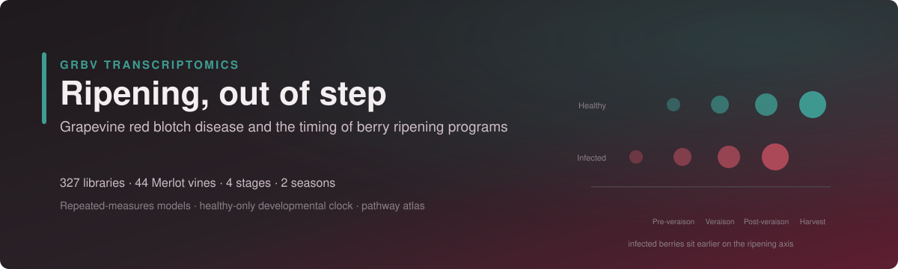

<div align="center">
  
  <h1>GRBV Transcriptomics Analysis</h1>
  <p><strong>Infected berries are not simply late. Their ripening programs fall out of step.</strong></p>
  <p>327 libraries · 44 Merlot vines · 4 stages · 2 seasons</p>
  <a href="#what-the-study-found">Findings</a> ·
  <a href="#how-the-analysis-runs">Workflow</a> ·
  <a href="#quick-start">Quick start</a> ·
  <a href="#how-the-analysis-got-here">History</a> ·
  <a href="#license-and-citation">Cite</a>
</div>

<p align="center">
  <a href="LICENSE"></a>
  
  
  
  
</p>

Analysis code for a repeated-measures RNA-seq study of **grapevine red blotch virus (GRBV)** in *Vitis vinifera* cv. Merlot berries. A healthy-only developmental reference separates the common ripening delay in infected fruit from changes that individual programs make on top of it. Network, multi-omics, pathway and cross-study analyses run as a Snakemake workflow on the UC Davis FARM cluster; figures are R scripts.

> [!NOTE]
> **The manuscript is a complete scientific draft (October 2026), not yet submitted.** Raw reads, the count matrix and the manuscript are not public yet, so this repository holds code only. See [Known limits](#known-limits).

## What the study found


| Finding | Status | Evidence |
|---|---|---|
| Common displacement toward earlier ripening states | 🟢 **Supported** | Harvest −0.804 stage units in 2021 (FDR 0.0008), −0.148 in 2022 (FDR 0.034) |
| Photosystem genes carry an extra timing shift | 🟢 **Supported** | −0.339 and −0.396 beyond the common shift, FDR 0.0016 in both seasons |
| Small heat-shock genes fall in level, not timing | 🟢 **Supported** | 31 of 34 lower at harvest in each season; branch clock fails season transfer |
| Translation splits by compartment | 🟢 **Supported** | Cytosolic down (−0.21, −0.30), chloroplast-associated up (+0.40, +0.44) |
| RNA-silencing genes rise early | 🟢 **Supported** | DCL2 and RDR1 up at veraison in both seasons, back to control levels at harvest |
| Infection effect depends on stage | 🟢 **Supported** | 7,861 host genes, infection × stage, FDR < 0.05 |
| Canonical immunity is not engaged | 🟢 **Supported** | 160 well-expressed NLRs detected like housekeeping genes; median \|log2FC\| 0.19 vs 1.06 for sHSPs |
| Responses differ between seasons | 🟠 **Season-dependent** | 3,236 three-way genes; 1,223 missed by season averaging; cytokinin and jasmonate flip |
| Lower Brix and pH in infected fruit | 🟠 **Descriptive** | Every infected harvest pool below its seasonal healthy pool; pooled triplicates |
| Independent studies agree on direction | 🔵 **Corroborated** | Zinfandel ρ 0.412 at harvest; Merlot ρ 0.72; Cabernet Sauvignon ρ 0.24 to 0.36 |
| Earlier headline claims | ⚪ **Withdrawn** | See [How the analysis got here](#how-the-analysis-got-here) |

**Supported** means the result passed its prespecified test with vines modelled as repeated units. **Corroborated** means an independent dataset agrees on direction, not that it validates the full model. **Descriptive** results are reported without inference.

All effects are relative RNA abundance. The study makes no claims about protein activity, hormone levels, metabolic flux or a causal role for temperature.

## How the analysis runs


| | Stage | What happens | In this repo |
|:-:|---|---|:-:|
| **①** | **Sequence and count** | TAG-seq libraries on Element AVITI; HTStream trimming, umi_tools deduplication, STAR against Pinot Noir ASM3070453v1, featureCounts. Done by the UC Davis Bioinformatics Core. | external |
| **②** | **Filter and audit units** | 28,168 features filtered to 14,604 (≥10 counts in ≥10% of libraries). Each analysis is checked for how many independent vines it really has. | local only |
| **③** | **Model expression** | Covariate-adjusted DESeq2 and limma-voom, then gene-wise mixed models with a vine random intercept (`variancePartition::dream`). | partly ([`de_deseq2_voom.R`](farm_pipeline/scripts/de_deseq2_voom.R)) |
| **④** | **Networks and multi-omics** | GENIE3, WGCNA preservation, NMF, differential co-expression, motifs, pseudotime, MOFA, mediation, defence repertoire and the agenda analyses (rules 00 to 19). | ✅ [`Snakefile`](farm_pipeline/Snakefile) |
| **⑤** | **Developmental clock and pathway atlas** | Healthy-only reference, 70 functional branches, rotation tests, 4,999 vine-bootstrap draws, leave-one-vine-out. | local only |
| **⑥** | **Validate and draw** | Concordance with published GRBV studies; R figure scripts and the figure atlas. | ✅ [`farm_pipeline/scripts/`](farm_pipeline/scripts/), [`figures/scripts_R/`](figures/scripts_R/) |

Libraries are repeated observations: each vine contributes up to eight libraries (4 stages × 2 seasons). There are 8 control vines, not 63 control plants.

## Quick start


**[Get the code](#1-get-the-code) → [Set up](#2-set-up-the-environments) → [Add data](#3-add-the-input-data) → [Run](#4-run-the-analysis)**

<a id="1-get-the-code"></a>


The repository is private; you need access to clone it.

```bash
git clone https://github.com/prem-p-singh/GRBV-Transcriptomics-Analysis.git
cd GRBV-Transcriptomics-Analysis
```

<a id="2-set-up-the-environments"></a>


**Local scripts** need Python 3 and the packages in [`requirements.txt`](requirements.txt). Figure scripts need R with ggplot2 and the packages each script loads.

```bash
pip install -r requirements.txt
```

**FARM.** [`setup_farm.sh`](farm_pipeline/setup_farm.sh) creates the `grbv-extended` Conda environment, installs R packages for `R/4.4.2` into `~/grbv_extended/Rlibs`, and downloads the reference genome, PlantTFDB TF list and JASPAR plant motifs. Started on a login node, it re-runs itself inside an `srun` job (account `publicgrp`, partition `low`). Every step skips work already done, so rerun it if the job is preempted.

<a id="3-add-the-input-data"></a>


Input data are not in the repository. [`push.sh`](farm_pipeline/push.sh) copies them from `~/Data_Analysis/` into `farm_pipeline/data/` and syncs the pipeline to `farm:~/grbv_extended/`.

| File | Contents |
|---|---|
| `counts_matrix.txt` | Raw counts, 28,168 features × 327 libraries |
| `sample_metadata.txt`, `sample_metadata_v2.txt` | Infection group, season, stage, infection year; v2 adds vine and biological-replicate IDs |
| `Virus titer.txt` | Viral titer by season, year, replicate and stage (copied as `Virus_titer.txt`) |
| `daily_2021.csv`, `daily_2022.csv` | Daily weather for each season |
| `MEs.csv`, `Module_genes.xlsx` | WGCNA module eigengenes and module membership |

```bash
cd farm_pipeline
bash push.sh
```

<a id="4-run-the-analysis"></a>


On FARM, start a `tmux` session first: the controller runs under `srun` and stops if the SSH session drops.

```bash
# On FARM
cd ~/grbv_extended
bash setup_farm.sh
bash run_farm.sh -n     # dry run: list the jobs Snakemake would submit
bash run_farm.sh        # submit; rerun to resume after preemption

# Back on the Mac, from farm_pipeline/
bash pull.sh            # copy results/ and logs/ back
```

[`run_farm.sh`](farm_pipeline/run_farm.sh) passes extra arguments to Snakemake and uses the [FARM profile](farm_pipeline/profiles/farm/config.yaml): SLURM executor, 10 concurrent jobs, `low` partition with requeue. Thresholds live in [`config/config.yaml`](farm_pipeline/config/config.yaml).

Figures are standalone R scripts that source [`theme_grbv.R`](figures/scripts_R/theme_grbv.R) and write PNG and SVG:

```bash
Rscript figures/scripts_R/S87_phenylpropanoid_kegg.R
python figures/scripts_R/build_full_atlas.py
```

## Find and interpret results


| Location | Contents |
|---|---|
| `farm_pipeline/results/<rule>/` | Per-rule tables and diagnostic plots (not publication figures) |
| `farm_pipeline/results/de_redo/`, `de_extras/` | DESeq2 and voom contrasts with a `stat` column |
| `farm_pipeline/logs/` | SLURM and rule logs |
| `figures/supp/`, `figures/main/` | Publication figures, PNG + SVG at 600 dpi |
| [`figures/GRBV_Full_Figure_Atlas.pdf`](figures/GRBV_Full_Figure_Atlas.pdf) | Every figure with its caption and status |
| `figures/supp/S{nn}_paralog_counts.csv` | Genes averaged at each KEGG node in S87 to S92 |

> [!TIP]
> Diagnostic plots in `results/` show that a rule ran. Paper figures are always re-drawn in R from the result tables. Read positive log2FC as higher in infected berries than in healthy berries of the same stage and season.

## How the analysis got here


The project went through seven analysis eras. Each asked a better-posed question than the one before, and several early headline claims were tested and withdrawn. Counts from different eras answer different questions, so they should not be compared directly.

| Era | Period | Approach | Outcome |
|:-:|---|---|---|
| 1 | Mar 2026 | Welch t-test per gene, no covariates | Scoped every analysis family; most headline counts later withdrawn |
| 2 | Apr 2026 | Networks and multi-omics on FARM | Modules preserved in infected vines; no severity subtypes; immunity flat |
| 3 | Apr 2026 | Threshold sweeps and self-review | Single-mediator result retired; classifier accuracy traced to viral features |
| 4 | Apr 2026 | Covariate-adjusted DESeq2 and voom | Pooled signature 908 → 126 genes; 1,025 at harvest |
| 5 | Apr to Jun 2026 | External validation | Cross-cultivar replication; reference bias tested by re-quantification |
| 6 | Aug 2026 | Mixed models and claim gates | A recorded verdict for every proposed claim |
| 7 | Sep 2026 | Developmental clock and pathway rotation tests | Timing separated from level; data provenance closed |

<details>
<summary><strong>Claims withdrawn along the way</strong></summary>

| Earlier claim | Why it was withdrawn |
|---|---|
| 908 universal DEGs | Confounded with ripening stage |
| 3-gene panel with AUC = 1.000 | Depended on viral transcripts; host-only, season-held-out AUC is 0.73 to 0.88 |
| MBF1c as the causal mediator | Bayesian vine model: −0.25 [−0.81, +0.33] |
| Three phases of chronic infection | Segmented regression selects zero breakpoints |
| Blocked sugar translocation | Sugar-transport module shows no infection effect |
| Vine tolerance gradient | Built on chemistry rows duplicated across RNA stages |
| Early burden predicts late damage | Failed both prespecified endpoints |
| Temperature causes the season effect | Two seasons cannot identify a causal climate mechanism |
| 60% QTL co-localisation | Computed on placeholder gene positions |

</details>

## Known limits


| Limit | What it means |
|---|---|
| 8 healthy vines | Control-side estimates rest on 8 biological units, sampled repeatedly |
| Two seasons | Season effects are reported; their climatic cause cannot be identified |
| Pooled harvest chemistry | One pool per season × cohort, measured in triplicate; no vine-level chemistry associations |
| Annotation-defined branches | Compartment and pathway assignments come from annotation, not localisation |
| Pinot Noir reference | Merlot reads mapped to Pinot Noir; genes significant under both references agree in direction 100% of the time |
| Data not deposited | Raw reads and counts are not yet in SRA or GEO |
| Local-only steps | The sample audit, mixed models and developmental clock (stages ②, ③, ⑤) are not yet in this repository |

> [!CAUTION]
> Earlier figures and decks in project history use withdrawn claims. Check a result against [What the study found](#what-the-study-found) before reusing it.

## License and citation


Source is [MIT licensed](LICENSE). External tools, annotations and datasets keep their own licenses. Cite with [CITATION.cff](CITATION.cff); the manuscript is in preparation:

> Singh, P.P., et al. *Grapevine red blotch disease alters the temporal coordination of fruit ripening programs.* In preparation.

The study began in the lab of **Dr. Anita Oberholster** (UC Davis Viticulture and Enology), who passed away in January 2025. It continued with **Dr. David E. Block** and is now carried out with **Dr. Mysore R. Sudarshana** (USDA-ARS and UC Davis Plant Pathology). RNA-seq processing by **Bradley N. Jenner**. Funded by CDFA and USDA. Computing on UC Davis FARM.

Maintained by **Prem Pratap Singh**, Department of Plant Pathology, University of California, Davis. Header graphics are generated by [`assets/make_readme_svgs.py`](assets/make_readme_svgs.py).
