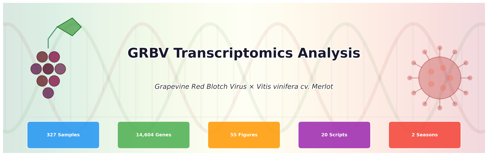
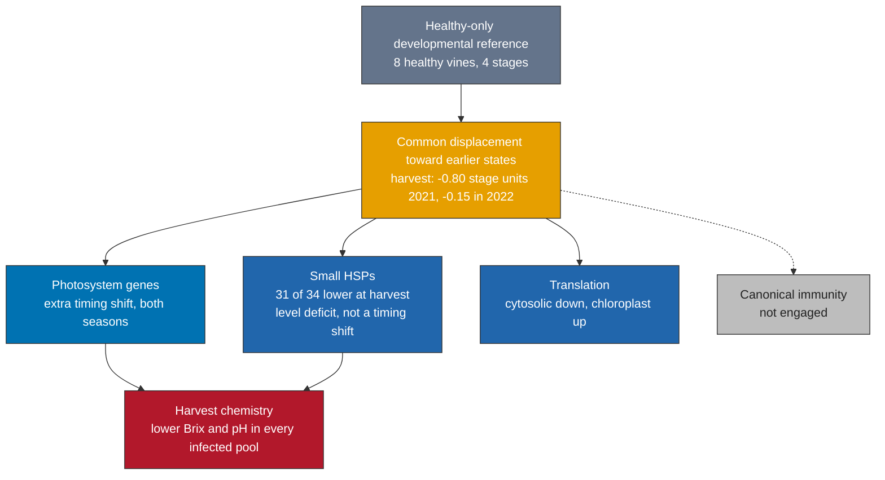

<p align="center">
  
</p>

<p align="center">
  
  
  
  
  
</p>

---

<div align="center">

*Grapevine red blotch disease alters the temporal coordination of fruit ripening programs.*
<br/>
*A repeated-measures RNA-Seq study of* ***Vitis vinifera*** *cv. Merlot berries across four ripening stages and two seasons.*

</div>

---

## The story in one diagram



<blockquote align="center">
<b>Infected berries are not simply late.</b><br/>
All infected fruit sits behind healthy fruit on a common ripening axis, and some programs move further on their own.<br/>
Photosystem genes keep an earlier timing, small heat-shock genes drop in level, and translation splits by compartment.<br/>
The result is altered coordination among ripening programs, not one uniform delay.
</blockquote>

---

## Study at a glance

| | |
|---|---|
| Species | *Vitis vinifera* cv. Merlot, one commercial vineyard |
| Design | 327 libraries from **44 vines** (36 GRBV-positive, 8 GRBV-negative); each vine sampled repeatedly |
| Seasons | 2021 and 2022 |
| Stages | Pre-veraison, Veraison, Post-veraison, Harvest |
| Infection cohorts | Onset years 2016 to 2022 |
| Sequencing | TAG-seq (UMI), Element AVITI, STAR + featureCounts against Pinot Noir ASM3070453v1 |
| Features | 28,168 raw, 14,604 after filtering (14,599 host + 5 viral) |
| Primary model | Gene-wise mixed models with a vine random intercept (`variancePartition::dream`), stage x season x infection cells, BH FDR < 0.05 |
| Chemistry | 11 pooled harvest samples, triplicate measurements (descriptive) |
| External data | Blanco-Ulate et al. 2017 (Zinfandel), Rumbaugh et al. 2022 (Cabernet Sauvignon), Rumbaugh et al. 2023 (Merlot) |

> Libraries are repeated observations, not independent plants. There are 8 control vines, not 63 control plants.

---

## Main findings

<table>
<tr><td align="center" width="50"><b>1</b></td><td>

### A healthy-only clock places every sample on a ripening axis

The reference is fitted on healthy samples only, using 1,000 background markers and excluding the 70 functional branches tested later. It predicts withheld healthy vines (62 of 63 nearest stage, RMSE 0.201) and a withheld season (58 of 63, RMSE 0.284). Infected berries sit behind healthy ones at harvest: **−0.804 stage units in 2021** (95% vine bootstrap −1.023 to −0.573, FDR 0.0008) and **−0.148 in 2022** (FDR 0.034).

</td></tr>
<tr><td align="center"><b>2</b></td><td>

### Harvest chemistry tells a different seasonal story

Every infected pool has lower soluble solids and pH than its seasonal healthy pool. The Brix deficit is 3.4 to 4.0 in 2021 and 8.9 to 10.9 in 2022. Titratable acidity and malic acid are higher in infected pools in 2021 and lower in 2022; YAN is lower in both. The larger Brix deficit falls in the season with the smaller transcriptional displacement, so chemistry and transcriptome capture different parts of the disease. Pools are measured in triplicate; the spread is measurement variation, not variation among vines.

</td></tr>
<tr><td align="center"><b>3</b></td><td>

### Photosystem genes carry an extra timing shift

The 44-gene photosystem and light-harvesting branch sits further toward earlier states than the common reference predicts: **−0.339 (2021) and −0.396 (2022)**, FDR 0.0016 in both seasons. Branch-specific timing predicts genes held out of the fit better than a shared expression-level shift. Of 35 branch models, 30 pass validation in withheld vines and seasons.

</td></tr>
<tr><td align="center"><b>4</b></td><td>

### Small heat-shock genes fall in level, not in timing

**31 of 34 small HSP genes** are significantly lower at harvest in each season (mean log2FC −2.29 in 2021, −1.58 in 2022). The deficit remains after adjusting for the common developmental position. The branch fails the season-transfer test for its own clock, so this is an expression deficit, not a different developmental age. HSFA2e and HSP18.2 both fall at harvest in both seasons; no regulatory link is claimed.

</td></tr>
<tr><td align="center"><b>5</b></td><td>

### Translation splits by compartment

Cytosolic translation-associated transcripts go down (−0.21, −0.30) while chloroplast-associated ones go up (+0.40, +0.44). Both branch tests pass in both seasons. Compartments come from annotation, and the values are relative RNA abundance.

</td></tr>
<tr><td align="center"><b>6</b></td><td>

### Other ripening programs keep their own schedules

Sucrose and starch synthesis rise late; the aggregate sugar-transporter branch does not change, so there is no sign of general transport repression. Expansin and pectin-hydrolysis genes rise after veraison. In phenylpropanoid metabolism, entry, lignin, anthocyanin and stilbene steps fall while flavonoid hydroxylation rises. ABA receptors fall late; cytokinin and jasmonate responses flip between seasons. RNA-silencing genes DCL2 and RDR1 rise at veraison in both seasons and return to control levels by harvest.

</td></tr>
<tr><td align="center"><b>7</b></td><td>

### Season matters, and averaging hides part of it

Infection x stage: **7,861** host genes at FDR < 0.05. Infection x stage x season: **3,236**, of which **1,223** are missed by the season-averaged test. The sHSP decrease and the opposing translation responses keep their direction in both seasons. The study has two seasons, so it reports season-dependent effects and makes no causal climate claim.

</td></tr>
<tr><td align="center"><b>8</b></td><td>

### Independent data agree on direction

Against the Zinfandel GRBV study, rank correlation rises from −0.066 before veraison to **0.412 at harvest** (64.5% sign agreement over 11,619 matched genes). Photosystem, sHSP and cytosolic-translation directions agree. Agreement is ρ 0.72 with Merlot (Rumbaugh 2023) and 0.24 to 0.36 with Cabernet Sauvignon (Rumbaugh 2022). Removing each of the 44 vines in turn keeps the harvest signs of the three main branches.

</td></tr>
<tr><td align="center"><b>9</b></td><td>

### Canonical immunity stays quiet, and it is not a detection problem

Of 676 curated resistance genes, 373 are silent in berry tissue. The 160 well-expressed ones are detected as reliably as housekeeping genes and move little (median |log2FC| 0.19, against 1.06 for small HSPs). This result has held under every analysis method used in the project.

</td></tr>
</table>

---

## How the analysis got here

The project went through seven analysis eras. Each asked a better-posed question than the last, and several early headline claims were tested and withdrawn. Counts from different eras answer different questions and should not be compared directly.

| Era | Period | Approach | Main outcome |
|---|---|---|---|
| 1 | Mar 2026 | Welch t-test per gene, no covariates | Scoped every analysis family; most headline counts later withdrawn |
| 2 | Apr 2026 | Networks and multi-omics on FARM (Snakemake) | Modules preserved in infected vines; no severity subtypes; immunity flat |
| 3 | Apr 2026 | Threshold sweeps + self-review | Single-mediator claim retired; ML accuracy shown to depend on viral features |
| 4 | Apr 2026 | Covariate-adjusted DESeq2 / limma-voom | Pooled signature 908 → 126 genes; harvest 1,025 genes |
| 5 | Apr to Jun 2026 | External validation | Cross-cultivar replication; reference bias tested by re-quantification |
| 6 | Aug 2026 | Mixed models with vine random effects + claim gates | Formal verdict on every claim |
| 7 | Sep 2026 | Developmental clock + pathway rotation tests | Timing separated from level; data provenance closed |

<details>
<summary><b>Claims withdrawn along the way</b></summary>

| Earlier claim | Why it was withdrawn |
|---|---|
| 908 universal DEGs | Confounded with ripening stage |
| 3-gene panel, AUC = 1.000 | Depended on viral transcripts; host-only, season-held-out AUC is 0.73 to 0.88 |
| MBF1c as the causal mediator | Bayesian vine model puts its effect at −0.25 [−0.81, +0.33] |
| Three phases of chronic infection | Segmented regression selects zero breakpoints |
| Blocked sugar translocation | Sugar-transport module shows no infection effect |
| Vine tolerance gradient | Built on chemistry rows duplicated across RNA stages |
| Early burden predicts late damage | Failed both prespecified endpoints |
| Temperature causes the season effect | Two seasons cannot identify a causal climate mechanism |
| 60% QTL co-localisation | Computed on placeholder gene positions |

</details>

---

## Repository layout

<details>
<summary><b>Click to expand</b></summary>

```
.
├── figures/
│   ├── scripts_R/          R / ggplot2 figure scripts; theme_grbv.R holds the shared theme
│   ├── supp/               KEGG and pathway-flow figures S87–S95 (tracked PNGs)
│   ├── cache/kegg_xml/     KGML cache for the pathway overlays
│   └── GRBV_Full_Figure_Atlas.pdf
├── farm_pipeline/
│   ├── Snakefile           21 analysis rules for the UC Davis FARM cluster
│   ├── scripts/            Rules 00–19, DE (DESeq2 / voom), sensitivity, Rumbaugh concordance
│   ├── config/, profiles/, envs/
│   ├── setup_farm.sh, run_farm.sh, push.sh, pull.sh
│   └── docs/LITERATURE_SCHEMA.md
├── scripts/                Literature ingest, ID crosswalk, deck updaters
├── Old-Analysis/           Era 1 Python scripts and builders (archived)
├── assets/                 README images
├── biochemistry_harvest_prep.py
├── requirements.txt
├── CLAUDE.md               Project memory and session history
└── README.md
```

Large inputs (count matrix, metadata, annotation database), results, the manuscript, the reports in `docs/`, and the Era 6 and Era 7 scripts are kept locally and are not in this repository.

</details>

---

## Running it

### Python environment

```bash
pip install -r requirements.txt
```

### Figures

Each figure is an R script in [`figures/scripts_R/`](figures/scripts_R/) that sources [`theme_grbv.R`](figures/scripts_R/theme_grbv.R) and writes PNG and SVG.

```bash
Rscript figures/scripts_R/S87_phenylpropanoid_kegg.R
python figures/scripts_R/build_full_atlas.py
```

### FARM pipeline

The Snakemake workflow runs on the UC Davis FARM cluster. `setup_farm.sh` and `run_farm.sh` start themselves inside an `srun` job when launched from a login node, so nothing heavy runs there.

```bash
cd farm_pipeline
bash setup_farm.sh      # conda env, R packages, annotation resources
bash run_farm.sh        # Snakemake controller; jobs go to partition low, account publicgrp
bash pull.sh            # copy results back to the local mirror
```

---

## Status

| Item | State |
|---|---|
| PNAS manuscript | Complete scientific draft (Oct 2026); author confirmations pending |
| Raw sequence deposition (SRA / GEO) | Not yet done |
| Chemistry-to-vine pairing | Needs collection records |
| Wet-lab validation | Not part of the current draft |

---

## Acknowledgments

<table>
<tr><td width="30%" align="right" valign="top"><b>In memoriam</b></td>
<td><b>Dr. Anita Oberholster</b> (UC Davis Viticulture and Enology) led this project until she passed away in January 2025. Her lab designed the field sampling and ran the wet-lab work.</td></tr>
<tr><td align="right" valign="top"><b>Mentor</b></td>
<td><b>Dr. Mysore R. Sudarshana</b>, USDA-ARS and UC Davis Plant Pathology.</td></tr>
<tr><td align="right" valign="top"><b>Former mentor</b></td>
<td><b>Dr. David E. Block</b>, UC Davis Viticulture and Enology.</td></tr>
<tr><td align="right" valign="top"><b>RNA-Seq processing</b></td>
<td><b>Bradley N. Jenner</b>: TAG-seq QC, HTStream, umi_tools, STAR, featureCounts.</td></tr>
<tr><td align="right" valign="top"><b>Funding</b></td>
<td>California Department of Food and Agriculture (CDFA) and USDA.</td></tr>
<tr><td align="right" valign="top"><b>Compute</b></td>
<td>UC Davis FARM HPC.</td></tr>
</table>

---

## Citing

<blockquote>
Singh, P.P., et al. (in preparation).<br/>
<i>Grapevine red blotch disease alters the temporal coordination of fruit ripening programs.</i>
</blockquote>

Contact: [ppssingh@ucdavis.edu](mailto:ppssingh@ucdavis.edu) · ORCID [0000-0001-7921-9379](https://orcid.org/0000-0001-7921-9379) · [prempsingh.com](https://prempsingh.com)

---

<p align="center"><sub>MIT License · see <a href="LICENSE">LICENSE</a></sub></p>
