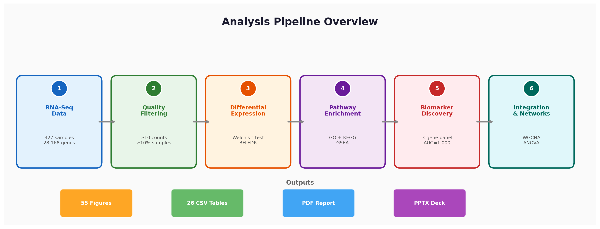
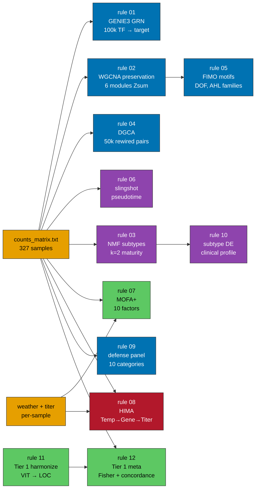

<p align="center">
  
</p>

<p align="center">
  
  
  
  
  
</p>

---

<div align="center">

*The FARM-side extended analysis pipeline for the main GRBV study:*
<br/>
*10 base rules (GRN, WGCNA preservation, NMF, DGCA, motifs, pseudotime, MOFA, HIMA,*
<br/>
*defense repertoire, subtype characterisation) plus post-hoc re-analysis scripts*
<br/>
*(DESeq2 + voom DE, causal mediation, LOSO biomarker, QTL permutation, NCBI annotations).*

</div>

---

## Pipeline at a glance



<blockquote align="center">
<b>13 rules run on FARM in one Snakemake invocation.</b><br/>
<b>Each rule is a single SLURM job with <code>--requeue=true</code>,</b><br/>
<b>so preemption on partition <code>low</code> auto-restarts without losing work.</b>
</blockquote>

---

## Rules at a glance

| # | Rule | Tool | What it adds |
|---|------|------|--------------|
| 00 | `weather_aggregate` | pandas | Per-sample weather window (14 d pre-sample) from CIMIS |
| 01 | `grn_inference` | GENIE3 | Directed TF → target edges (regulators = PlantTFDB Vvi) |
| 02 | `module_preservation` | WGCNA::modulePreservation | Tests whether RB− co-expression modules persist in RB+ |
| 03 | `subtype_discovery` | Consensus NMF | Latent-subtype search in RB+ samples (`k = 2–6`) |
| 04 | `diffcoex` | DGCA | Gene pairs with significantly changed correlation RB+ vs RB− |
| 05 | `motif_enrichment` | FIMO + JASPAR plants | Cis-motifs enriched in each WGCNA module's promoters |
| 06 | `pseudotime` | slingshot + tradeSeq | Infection-age trajectory and temporally variable genes |
| 07 | `mofa_integration` | MOFA+ | Latent factors across expression + titer + weather |
| 08 | `hima_mediation` | HIMA | Multi-mediator Temperature → Genes → Titer |
| 09 | `defense_repertoire` | keyword + DE | Curated NLR / PRR / PR / SA / JA / ET panel |
| 10 | `subtype_characterize` | *t*-test + χ² | DE and clinical associations for subtypes from rule 03 |
| 11 | `harmonize_literature_degs` | pandas + crosswalk | Maps literature DEG tables to NCBI `LOC_*` space |
| 12 | `comparative_metaanalysis` | Fisher + Spearman | Tier 1 overlap + FC concordance vs GRBV signature |

Post-hoc review-response scripts (historically named `fix01`–`fix11`; see [`../docs/CRITICAL_REVIEW.md`](../docs/CRITICAL_REVIEW.md) for the naming-provenance mapping):

| Script | Replaces | Why |
|--------|----------|-----|
| `de_deseq2_voom.R` | Welch *t*-test in `analysis.py` | Covariate-adjusted DESeq2 + limma-voom; 24 contrasts |
| `de_repeated_measures_voom.R` | n/a | `duplicateCorrelation(block = vine_id)` sensitivity check |
| `de_deseq2_extras.R` | n/a | Q1a / Q1b / Q2x (stage × season) / Q4d DESeq2 contrasts |
| `mediation_tv2000.py` | `causal_mediation_analysis.py` (tv = 500) | Raises top-var threshold to 2,000; 39 mediators vs 0 |
| `biomarker_loso_cv.py` | `advanced_ml_biomarkers.py` (5-fold CV) | Leave-one-season-out CV, host-only panel |
| `regen_figs49_50.py` | n/a | Rebuilds Figs 49 / 50 from post-fix mediation results |
| `qtl_permutation_null.py` | `gwas_qtl_crossref.py` (no null) | 10,000-perm chromosome-stratified null for QTL overlap |
| `ncbi_annotations.py` | n/a | NCBI Entrez lookup for 86 LOC_* key genes |

---

## One-time setup on FARM

From your Mac:

```bash
cd ~/Data_Analysis/farm_pipeline
bash push.sh                                           # rsync pipeline + inputs to farm:~/grbv_extended/
ssh farm "cd ~/grbv_extended && bash setup_farm.sh"    # conda env + genome + TF + motif downloads (~2–3 GB)
```

`setup_farm.sh` creates the `grbv-extended` conda env and downloads:

- NCBI *V. vinifera* reference genome + GFF (`GCF_030704535.1`)
- PlantTFDB *Vvi* TF list
- JASPAR2024 CORE plants motif database

---

## Running the pipeline

```bash
ssh farm "cd ~/grbv_extended && bash run_farm.sh --cores 40"

# Dry-run first:
ssh farm "cd ~/grbv_extended && bash run_farm.sh -n"

# Rerun a single rule:
ssh farm "cd ~/grbv_extended && bash run_farm.sh -R module_preservation"
```

All rules submit as separate SLURM jobs via the `profiles/farm/` executor profile. They are preempt-safe (`--requeue=true`).

<details>
<summary><b>Expected walltimes</b></summary>

| Rule | Walltime | CPUs | Mem |
|---|---|---|---|
| 01 GRN | 6 h | 16 | 32 G |
| 02 mod-pres | 3 h | 8 | 16 G |
| 03 NMF | 1.5 h | 4 | 8 G |
| 04 DGCA | 2 h | 8 | 16 G |
| 05 motif (05a + 05b) | 1.5 h | 4 | 8 G |
| 06 pseudotime | 1 h | 4 | 8 G |
| 07 MOFA | 2 h | 4 | 16 G |
| 08 HIMA | 3 h | 8 | 16 G |
| 09 defense | 30 m | 2 | 4 G |
| 10 subtype char. | 30 m | 2 | 4 G |
| 11 harmonize | 10 m | 2 | 4 G |
| 12 metaanalysis | 15 m | 2 | 4 G |

</details>

### Pulling results back

```bash
cd ~/Data_Analysis/farm_pipeline
bash pull.sh                                           # rsync results/ + logs/ from FARM
```

---

## Directory layout

<details>
<summary><b>Click to expand</b></summary>

```
farm_pipeline/
├── Snakefile                    orchestrator (13 rules)
├── config/config.yaml           thresholds / URLs / sampling dates
├── profiles/farm/config.yaml    SLURM executor (low, publicgrp, --requeue)
├── envs/grbv-extended.yaml      conda env spec
├── scripts/                     13 pipeline + 8 post-hoc analysis scripts
├── data/                        inputs staged by push.sh
│   └── literature/              Tier 1 DEG tables (6 papers, 18 contrasts)
├── resources/                   downloads populated by setup_farm.sh
│   ├── genome/                  ASM3070453v1 reference + GFF
│   ├── motifs/, tfs/            JASPAR2024 + PlantTFDB
│   └── id_crosswalk.tsv         24,817-row VIT ↔ LOC ↔ Vvi ↔ Symbol map
├── results/                     outputs (rsync'd back via pull.sh)
│   ├── 00_weather … 12_metaanalysis    numbered rule outputs
│   ├── de_redo/, de_extras/            covariate-adjusted DESeq2 + voom
│   ├── mediation/                      causal-mediation tv=2,000 results
│   ├── qtl/                            permutation null
│   └── annotations/                    NCBI Entrez gene names
├── logs/                        per-rule stderr / stdout
├── docs/                        FARM-side documentation
│   └── LITERATURE_SCHEMA.md     Tier 1 meta-analysis input contract
├── setup_farm.sh                one-time bootstrap on FARM
├── push.sh                      Mac → FARM sync
├── pull.sh                      FARM → Mac sync
├── run_farm.sh                  Snakemake launcher
└── FARM_HPC.md                  cluster quick-start notes
```

</details>

---

## Gotchas

- **Disk (20 GB cap):** genome + GFF + motifs ≈ 2–3 GB. Data inputs ≈ 25 MB. Intermediate outputs are CSV / PNG only (no BAM). Total usage stays < 6 GB.
- **Preemption on `low`:** every rule sets `requeue = true` and the SLURM account / partition / QOS from `config.yaml`. Snakemake `restart-times: 2` retries twice before failing.
- **`MEs.csv` mismatch:** the legacy `MEs.csv` uses different sample IDs (`16H1`…) than `counts_matrix.txt` (`S01`…). All rules that need module eigengenes recompute them from counts, no dependency on the mismatched file.
- **Stage spelling:** the viral-titer file uses `Pre_véraison` / `Véraison` (accented); scripts map these to the unaccented `Pre_veraison` used in `sample_metadata.txt`.
- **Weather is per-sample,** aggregated in a configurable window (default 14 days) ending on each sample's sampling date. Dates live in `config/config.yaml` under `sampling_dates`; tweak `weather_window.days_before` / `base_temp_gdd` to change the window / GDD base. Rule 00 produces `results/00_weather/weather_per_sample.csv` (`tavg_mean`, `tmax_max`, `tmin_min`, `gdd_sum`, `precip_sum`, `rh_mean`) consumed by both MOFA (rule 07) and HIMA (rule 08).
- **Module sheet names** in `Module_genes.xlsx` must match sheet names; the motif enrichment script reads every sheet and assumes column 1 carries gene IDs.

---

## Troubleshooting

| Issue | Fix |
|---|---|
| `conda: command not found` in SLURM job | rule wrapper does `source /etc/profile.d/modules.sh; module load conda/base` — if still failing, check `logs/<rule>.log` for an earlier error |
| `fimo: not found` | `meme` not installed in env; activate env and run `meme -version` to confirm |
| HIMA runs out of memory | lower `hima.top_var` in `config/config.yaml` |
| GENIE3 too slow | lower `grn.n_trees` (default 1000 → 500) |
| Job preempted mid-run | Snakemake + `--requeue=true` auto-resubmits; `restart-times: 2` in the profile retries twice |
| `~/grbv_extended/results/fix*` directories after rename | run the FARM rename snippet in [`../docs/CRITICAL_REVIEW.md`](../docs/CRITICAL_REVIEW.md) before the next `pull.sh` |

---

<div align="center">

**Part of the [GRBV Transcriptomics Analysis](../README.md) project**
<br/>
*Prem Pratap Singh · UC Davis Viticulture & Enology · 2024–2026*

</div>
